# 🏛️ Hawassa MESOB System - UML Class Diagram Documentation

## Overview

This document specifies the complete **Unified Modeling Language (UML) Class Diagram** for the Hawassa MESOB Public Service Management System. 

The architecture is divided into two comprehensive diagrams:
1. **Domain Model Class Diagram**: Shows the Object-Oriented domain entities, attributes, methods, enumerations, and relationships across all 6 stakeholder roles.
2. **Backend Service & Controller Architecture Class Diagram**: Illustrates the 3-tier API architecture (Controllers, Service Layer, and Database/Supabase Data Layer).

---

## 1. 📦 Domain Model Class Diagram

```mermaid
classDiagram
    direction TB

    %% ==========================================
    %% ENUMERATIONS
    %% ==========================================
    class UserRole {
        <<enumeration>>
        CUSTOMER
        EMPLOYEE
        TECHNICIAN
        INSTITUTION_MANAGER
        MESOB_MANAGER
        SUPER_ADMIN
    }

    class UserStatus {
        <<enumeration>>
        ACTIVE
        INACTIVE
        SUSPENDED
        PENDING
    }

    class ApplicationStatus {
        <<enumeration>>
        DRAFT
        SUBMITTED
        UNDER_REVIEW
        ADDITIONAL_INFO_REQUIRED
        APPROVED
        REJECTED
        COMPLETED
        CANCELLED
    }

    class QueueStatus {
        <<enumeration>>
        WAITING
        CALLED
        IN_SERVICE
        COMPLETED
        NO_SHOW
        CANCELLED
    }

    class MaintenanceStatus {
        <<enumeration>>
        REPORTED
        ASSIGNED
        IN_PROGRESS
        ON_HOLD
        RESOLVED
        CLOSED
    }

    class NotificationType {
        <<enumeration>>
        APPLICATION_STATUS
        QUEUE_CALL
        MAINTENANCE_ALERT
        SYSTEM_MESSAGE
    }

    class ApprovalStatus {
        <<enumeration>>
        PENDING_APPROVAL
        APPROVED
        REJECTED
    }

    %% ==========================================
    %% CORE BASE USER & SPECIALIZED STAKEHOLDERS
    %% ==========================================
    class User {
        <<abstract>>
        +UUID id
        +String email
        #String password_hash
        +String full_name
        +String phone
        +UserRole role
        +UserStatus status
        +UUID institution_id
        +String employee_id
        +String national_id
        +DateTime created_at
        +DateTime updated_at
        +JSONB metadata
        +login(email, password) Boolean
        +updateProfile(profileData) User
        +changePassword(oldPass, newPass) Boolean
        +getNotifications() Notification[]
        +markNotificationRead(notificationId) void
    }

    class Customer {
        +submitApplication(serviceId, appData, docs) Application
        +trackApplication(appNumber) Application
        +cancelApplication(appId) Boolean
        +generateQueueTicket(serviceId) QueueEntry
        +getLiveQueuePosition(queueId) Integer
        +submitServiceFeedback(serviceId, rating, comment) ServiceFeedback
    }

    class Employee {
        +viewAssignedApplications() Application[]
        +verifyDocuments(applicationId) Boolean
        +reviewApplication(applicationId, status, notes) Application
        +callNextQueueTicket(counterNumber) QueueEntry
        +startQueueServing(queueId) void
        +completeQueueService(queueId, completionNotes) void
        +reportEquipmentFault(title, description, location) MaintenanceReport
    }

    class Technician {
        +viewAssignedMaintenanceReports() MaintenanceReport[]
        +updateReportStatus(reportId, status) MaintenanceReport
        +updateTaskStatus(taskId, status, notes) MaintenanceTask
        +uploadRepairAttachment(reportId, file) MaintenanceAttachment
        +resolveReport(reportId, resolutionNotes) MaintenanceReport
    }

    class InstitutionManager {
        +assignApplicationToEmployee(appId, employeeId) Application
        +createService(serviceData) Service
        +updateService(serviceId, serviceData) Service
        +configureServiceRequirements(serviceId, reqs) ServiceRequirement[]
        +assignMaintenanceTask(reportId, technicianId) MaintenanceTask
        +getInstitutionMetrics() Object
    }

    class MesobManager {
        +getPendingApprovalQueue() Object
        +reviewInstitution(institutionId, decision, reason) Institution
        +reviewManagerAccount(userId, decision, reason) User
        +broadcastAnnouncement(announcementData) Announcement
        +getCenterWideOverview() Object
    }

    class SuperAdmin {
        +registerInstitution(institutionData) Institution
        +registerStaffUser(userData) User
        +manageUserRole(userId, newRole) User
        +suspendUser(userId, reason) void
        +viewAuditLogs(filterCriteria) AuditLog[]
        +getSystemHealthStatus() Object
    }

    %% ==========================================
    %% BUSINESS ENTITIES
    %% ==========================================
    class Institution {
        +UUID id
        +String code
        +String name_en
        +String name_am
        +String description
        +String logo_url
        +String email
        +String phone
        +String address
        +String status
        +JSONB metadata
        +DateTime created_at
        +getServices() Service[]
        +getStaff() User[]
        +isApproved() Boolean
    }

    class Service {
        +UUID id
        +UUID institution_id
        +String code
        +String title_en
        +String title_am
        +String description_en
        +String description_am
        +String processing_time
        +String service_fee
        +Boolean is_active
        +DateTime created_at
        +getRequirements() ServiceRequirement[]
    }

    class ServiceRequirement {
        +UUID id
        +UUID service_id
        +String document_name_en
        +String document_name_am
        +String description_en
        +Boolean is_mandatory
        +Integer display_order
    }

    class Application {
        +UUID id
        +String application_number
        +UUID customer_id
        +UUID service_id
        +UUID institution_id
        +UUID assigned_to
        +UUID reviewed_by
        +ApplicationStatus status
        +JSONB application_data
        +JSONB documents
        +String review_notes
        +DateTime submitted_at
        +DateTime reviewed_at
        +DateTime completed_at
        +assignTo(employeeId) void
        +approve(reviewerId, notes) void
        +reject(reviewerId, reason) void
    }

    class QueueEntry {
        +UUID id
        +String queue_number
        +UUID customer_id
        +UUID service_id
        +UUID institution_id
        +UUID assigned_to
        +QueueStatus status
        +String priority
        +DateTime assigned_at
        +DateTime started_at
        +DateTime completed_at
        +String notes
        +callTicket(counter) void
        +complete() void
    }

    class MaintenanceReport {
        +UUID id
        +String report_number
        +UUID reported_by
        +UUID institution_id
        +UUID assigned_to
        +UUID resolved_by
        +String title
        +String description
        +String location
        +String equipment_info
        +String priority
        +MaintenanceStatus status
        +String resolution_notes
        +DateTime resolved_at
        +assignTechnician(techId) void
        +resolve(notes, resolverId) void
    }

    class MaintenanceTask {
        +UUID id
        +UUID maintenance_report_id
        +UUID assigned_to
        +UUID assigned_by
        +String title
        +String description
        +String status
        +DateTime completed_at
        +String completion_notes
        +completeTask(notes) void
    }

    class MaintenanceAttachment {
        +UUID id
        +UUID maintenance_report_id
        +String file_name
        +String file_type
        +Integer file_size
        +String file_url
        +UUID uploaded_by
        +DateTime uploaded_at
    }

    class Notification {
        +UUID id
        +UUID recipient_id
        +NotificationType type
        +String title
        +String message
        +String related_entity_type
        +UUID related_entity_id
        +Boolean is_read
        +DateTime read_at
        +DateTime created_at
        +markAsRead() void
    }

    class Announcement {
        +UUID id
        +UUID published_by
        +UUID institution_id
        +String title
        +String content
        +String scope
        +Boolean is_pinned
        +Boolean is_active
        +DateTime published_at
        +DateTime expires_at
    }

    class ServiceFeedback {
        +UUID id
        +UUID customer_id
        +UUID institution_id
        +UUID service_id
        +UUID application_id
        +UUID queue_entry_id
        +Integer rating
        +String comment
        +String source
        +DateTime created_at
    }

    class AuditLog {
        +UUID id
        +UUID user_id
        +String action
        +String resource_type
        +UUID resource_id
        +JSONB old_values
        +JSONB new_values
        +String ip_address
        +DateTime created_at
    }

    %% ==========================================
    %% INHERITANCE / ROLE SPECIALIZATION
    %% ==========================================
    User <|-- Customer
    User <|-- Employee
    User <|-- Technician
    User <|-- InstitutionManager
    User <|-- MesobManager
    User <|-- SuperAdmin

    %% ==========================================
    %% CARDINALITY & ASSOCIATIONS
    %% ==========================================
    Institution "1" *-- "0..*" Service : offers
    Service "1" *-- "1..*" ServiceRequirement : mandates
    Institution "1" o-- "0..*" User : employs
    Customer "1" --> "0..*" Application : submits
    Employee "1" <-- "0..*" Application : processed_by
    Service "1" --> "0..*" Application : targets
    Institution "1" --> "0..*" Application : handles
    Customer "1" --> "0..*" QueueEntry : requests
    Employee "1" <-- "0..*" QueueEntry : serves
    Service "1" --> "0..*" QueueEntry : relates_to
    User "1" --> "0..*" MaintenanceReport : reports
    Technician "1" <-- "0..*" MaintenanceReport : maintains
    MaintenanceReport "1" *-- "0..*" MaintenanceTask : decomposes_to
    MaintenanceReport "1" *-- "0..*" MaintenanceAttachment : attaches
    Technician "1" <-- "0..*" MaintenanceTask : assigned_to
    Customer "1" --> "0..*" ServiceFeedback : rates
    Service "1" --> "0..*" ServiceFeedback : evaluated_in
    User "1" --> "0..*" Notification : receives
    User "1" --> "0..*" Announcement : publishes
    User "1" --> "0..*" AuditLog : triggers
```

---

## 2. 🏛️ Controller & Service Layer Class Diagram (System Architecture)

This diagram shows how backend Express controllers delegate business logic to services and query the Supabase PostgreSQL database:

```mermaid
classDiagram
    direction TB

    %% Controllers Layer
    class AuthController {
        +login(req, res)
        +register(req, res)
        +getMe(req, res)
        +logout(req, res)
    }

    class ApplicationController {
        +createApplication(req, res)
        +getMyApplications(req, res)
        +getInstitutionApplications(req, res)
        +assignApplication(req, res)
        +reviewApplication(req, res)
    }

    class QueueController {
        +generateTicket(req, res)
        +getActiveQueue(req, res)
        +callNext(req, res)
        +completeTicket(req, res)
    }

    class ApprovalController {
        +getPendingApprovals(req, res)
        +approveInstitution(req, res)
        +rejectInstitution(req, res)
        +approveUser(req, res)
        +rejectUser(req, res)
    }

    class MaintenanceController {
        +createReport(req, res)
        +getReports(req, res)
        +assignTechnician(req, res)
        +updateTaskStatus(req, res)
        +resolveReport(req, res)
    }

    class NotificationController {
        +getUserNotifications(req, res)
        +markAsRead(req, res)
        +markAllAsRead(req, res)
    }

    class FeedbackController {
        +submitFeedback(req, res)
        +getServiceFeedback(req, res)
        +getInstitutionFeedbackStats(req, res)
    }

    %% Service Layer
    class AuthService {
        +authenticateUser(email, password)
        +generateAuthToken(user)
        +validateSession(token)
    }

    class ApplicationService {
        +createApplication(customerId, serviceId, data, files)
        +assignToEmployee(appId, employeeId, assignerId)
        +updateStatus(appId, status, notes, reviewerId)
        +generateApplicationNumber(instCode, svcCode)
    }

    class QueueService {
        +issueTicket(customerId, serviceId, institutionId)
        +callNextTicket(counterId, staffId)
        +completeTicket(queueId, staffId)
        +getLiveQueueState(institutionId)
    }

    class ApprovalService {
        +submitForApproval(entityType, entityData, requesterId)
        +getPendingList(entityType)
        +approve(entityType, entityId, managerId)
        +reject(entityType, entityId, reason, managerId)
    }

    class MaintenanceService {
        +submitReport(reporterId, data)
        +assignTicket(reportId, techId, managerId)
        +updateTask(taskId, status, notes)
        +resolveTicket(reportId, resolutionNotes, techId)
    }

    class NotificationService {
        +sendNotification(recipientId, type, title, message, refEntity)
        +getUnreadCount(userId)
        +markRead(notificationId, userId)
    }

    class FeedbackService {
        +createFeedback(customerId, serviceId, rating, comment)
        +calculateAverageRating(serviceId)
    }

    %% Data Layer
    class SupabaseDatabaseClient {
        +from(tableName)
        +select(query)
        +insert(payload)
        +update(payload)
        +delete(id)
        +rpc(functionName, params)
    }

    %% Controller -> Service Dependencies
    AuthController ..> AuthService : invokes
    ApplicationController ..> ApplicationService : invokes
    QueueController ..> QueueService : invokes
    ApprovalController ..> ApprovalService : invokes
    MaintenanceController ..> MaintenanceService : invokes
    NotificationController ..> NotificationService : invokes
    FeedbackController ..> FeedbackService : invokes

    %% Cross-Service Collaboration
    ApplicationService ..> NotificationService : notifies
    QueueService ..> NotificationService : notifies
    ApprovalService ..> NotificationService : notifies
    MaintenanceService ..> NotificationService : notifies

    %% Service -> Database Dependency
    AuthService ..> SupabaseDatabaseClient : queries
    ApplicationService ..> SupabaseDatabaseClient : queries
    QueueService ..> SupabaseDatabaseClient : queries
    ApprovalService ..> SupabaseDatabaseClient : queries
    MaintenanceService ..> SupabaseDatabaseClient : queries
    NotificationService ..> SupabaseDatabaseClient : queries
    FeedbackService ..> SupabaseDatabaseClient : queries
```

