# 🗄️ Hawassa MESOB Database Schema Documentation

## Overview

This document describes the complete PostgreSQL database schema for the Hawassa MESOB Public Service Information System.

**Database:** Supabase PostgreSQL  
**Version:** 1.0.0  
**Total Tables:** 12  
**Total Views:** 6  
**Total Functions:** 7  

---

## 📊 Database Statistics

| Metric | Count |
|--------|-------|
| Tables | 12 |
| Views | 6 |
| Functions | 7 |
| Enums | 10 |
| Indexes | 60+ |
| Foreign Keys | 25+ |
| RLS Policies | 50+ |

---

## 🎯 User Roles & Workflow Responsibilities

The system has **exactly 6 approved roles**:

1. **CUSTOMER**: End-user service applicant and queue ticket holder. **Requesters only**; cannot receive task assignments.
2. **EMPLOYEE**: Institutional operational staff. **Service-application work assignees**; cannot receive maintenance tasks or assign work across institutions.
3. **TECHNICIAN**: Institutional IT maintenance specialists. **Maintenance task assignees**; cannot receive service application work.
4. **INSTITUTION_MANAGER**: Institutional director. **Task assigner & supervisor within permitted institutional scope only**.
5. **MESOB_MANAGER**: Center-wide operations manager. Cross-institutional oversight.
6. **SUPER_ADMIN**: System administrator. Complete system and user management access.

---

## 🗺️ Entity-Relationship (ER) Diagram

```mermaid
erDiagram
    users {
        UUID id PK
        VARCHAR email UK
        user_role role "CUSTOMER | EMPLOYEE | TECHNICIAN | INSTITUTION_MANAGER | MESOB_MANAGER | SUPER_ADMIN"
        UUID institution_id FK
        VARCHAR full_name
        user_status status
    }

    institutions {
        UUID id PK
        VARCHAR code UK
        VARCHAR name_en
        VARCHAR name_am
        institution_status status
    }

    services {
        UUID id PK
        UUID institution_id FK
        VARCHAR code
        VARCHAR title_en
        VARCHAR title_am
        BOOLEAN is_active
    }

    applications {
        UUID id PK
        VARCHAR application_number UK
        UUID customer_id FK "Requester: users.id (CUSTOMER)"
        UUID service_id FK "Requested Service: services.id"
        UUID institution_id FK "Target Institution: institutions.id"
        UUID assigned_to FK "Assignee: users.id (EMPLOYEE only)"
        UUID reviewed_by FK "Reviewer: users.id (Manager/Employee)"
        application_status status
    }

    queue_entries {
        UUID id PK
        VARCHAR queue_number UK
        UUID customer_id FK "Requester: users.id (CUSTOMER)"
        UUID service_id FK "services.id"
        UUID institution_id FK "institutions.id"
        UUID assigned_to FK "Desk Staff: users.id (EMPLOYEE only)"
        queue_status status
    }

    maintenance_reports {
        UUID id PK
        VARCHAR report_number UK
        UUID reported_by FK "Reporter: users.id (EMPLOYEE/STAFF)"
        UUID institution_id FK "institutions.id"
        UUID assigned_to FK "Assignee: users.id (TECHNICIAN only)"
        UUID resolved_by FK "Resolver: users.id (TECHNICIAN)"
        maintenance_status status
    }

    maintenance_tasks {
        UUID id PK
        UUID maintenance_report_id FK "maintenance_reports.id"
        UUID assigned_to FK "Assignee: users.id (TECHNICIAN only)"
        UUID assigned_by FK "Assigner: users.id (INSTITUTION_MANAGER/ADMIN)"
        task_status status
    }

    service_feedback {
        UUID id PK
        UUID customer_id FK "Author: users.id (CUSTOMER only)"
        UUID institution_id FK "institutions.id"
        UUID service_id FK "services.id"
        INTEGER rating "1 to 5"
    }

    users ||--o{ applications : "submits as Customer (customer_id)"
    users ||--o{ applications : "processes as Employee (assigned_to)"
    users ||--o{ queue_entries : "joins as Customer (customer_id)"
    users ||--o{ queue_entries : "handles as Employee (assigned_to)"
    users ||--o{ maintenance_reports : "reports as Staff (reported_by)"
    users ||--o{ maintenance_reports : "maintains as Technician (assigned_to)"
    users ||--o{ maintenance_tasks : "works on as Technician (assigned_to)"
    users ||--o{ maintenance_tasks : "assigns as Manager (assigned_by)"
    users ||--o{ service_feedback : "rates as Customer (customer_id)"
    institutions ||--o{ users : "employs (staff roles)"
    institutions ||--o{ services : "provides"
    institutions ||--o{ applications : "processes"
    institutions ||--o{ maintenance_reports : "maintains equipment"
    services ||--o{ applications : "receives"
```



---

## 📋 Tables

### 1. users
**Purpose:** Core user table for all system users

| Column | Type | Description |
|--------|------|-------------|
| id | UUID | Primary key |
| email | VARCHAR(255) | Unique email address |
| password_hash | VARCHAR(255) | Hashed password |
| full_name | VARCHAR(255) | User's full name |
| phone | VARCHAR(20) | Contact number |
| role | user_role | User role (enum) |
| status | user_status | Account status |
| institution_id | UUID | FK to institutions (nullable) |
| employee_id | VARCHAR(50) | Employee/Staff ID |
| profile_photo_url | TEXT | Profile photo URL |
| national_id | VARCHAR(50) | National ID number |
| created_at | TIMESTAMPTZ | Creation timestamp |
| updated_at | TIMESTAMPTZ | Last update timestamp |
| last_login_at | TIMESTAMPTZ | Last login timestamp |
| created_by | UUID | FK to users (creator) |
| metadata | JSONB | Additional data |

**Indexes:** 6  
**Unique Constraints:** email  
**Foreign Keys:** institution_id → institutions, created_by → users  

---

### 2. institutions
**Purpose:** 12 approved government institutions

| Column | Type | Description |
|--------|------|-------------|
| id | UUID | Primary key |
| code | VARCHAR(50) | Unique institution code |
| name_en | VARCHAR(255) | English name |
| name_am | VARCHAR(255) | Amharic name |
| description | TEXT | Institution description |
| logo_url | TEXT | Logo image URL |
| website_url | TEXT | Official website |
| email | VARCHAR(255) | Contact email |
| phone | VARCHAR(20) | Contact phone |
| address | TEXT | Physical address |
| status | institution_status | Active/Inactive |
| created_at | TIMESTAMPTZ | Creation timestamp |
| updated_at | TIMESTAMPTZ | Last update timestamp |
| metadata | JSONB | Additional data |

**Indexes:** 3  
**Unique Constraints:** code  
**Institutions:** 12 (electric, revenue, justice, cbe, ethiotel, ethiopost, investment, labor, trade, construction, fayda, sidama-bank)  

---

### 3. services
**Purpose:** Services offered by institutions

| Column | Type | Description |
|--------|------|-------------|
| id | UUID | Primary key |
| institution_id | UUID | FK to institutions |
| code | VARCHAR(100) | Service code (unique per institution) |
| title_en | VARCHAR(255) | English title |
| title_am | VARCHAR(255) | Amharic title |
| description_en | TEXT | English description |
| description_am | TEXT | Amharic description |
| processing_time | VARCHAR(100) | Expected processing time |
| service_fee | VARCHAR(100) | Service fee |
| service_url | TEXT | Service information URL |
| is_active | BOOLEAN | Active status |
| created_at | TIMESTAMPTZ | Creation timestamp |
| updated_at | TIMESTAMPTZ | Last update timestamp |
| metadata | JSONB | Additional data |

**Indexes:** 4  
**Unique Constraints:** (institution_id, code)  
**Foreign Keys:** institution_id → institutions  

---

### 4. service_requirements
**Purpose:** Required documents for each service

| Column | Type | Description |
|--------|------|-------------|
| id | UUID | Primary key |
| service_id | UUID | FK to services |
| document_name_en | VARCHAR(255) | English document name |
| document_name_am | VARCHAR(255) | Amharic document name |
| description_en | TEXT | English description |
| description_am | TEXT | Amharic description |
| is_mandatory | BOOLEAN | Required or optional |
| display_order | INTEGER | Display order |
| created_at | TIMESTAMPTZ | Creation timestamp |
| updated_at | TIMESTAMPTZ | Last update timestamp |

**Indexes:** 2  
**Foreign Keys:** service_id → services  

---

### 5. applications
**Purpose:** Customer applications for services

| Column | Type | Description |
|--------|------|-------------|
| id | UUID | Primary key |
| application_number | VARCHAR(50) | Unique tracking number |
| customer_id | UUID | FK to users (applicant) |
| service_id | UUID | FK to services |
| institution_id | UUID | FK to institutions |
| status | application_status | Application status |
| application_data | JSONB | Form data |
| documents | JSONB | Uploaded documents |
| assigned_to | UUID | FK to users (employee) |
| reviewed_by | UUID | FK to users (reviewer) |
| review_notes | TEXT | Review notes |
| submitted_at | TIMESTAMPTZ | Submission timestamp |
| reviewed_at | TIMESTAMPTZ | Review timestamp |
| completed_at | TIMESTAMPTZ | Completion timestamp |
| created_at | TIMESTAMPTZ | Creation timestamp |
| updated_at | TIMESTAMPTZ | Last update timestamp |
| metadata | JSONB | Additional data |

**Indexes:** 7  
**Unique Constraints:** application_number  
**Foreign Keys:** customer_id, service_id, institution_id, assigned_to, reviewed_by → users  

---

### 6. queue_entries
**Purpose:** Service queue management

| Column | Type | Description |
|--------|------|-------------|
| id | UUID | Primary key |
| queue_number | VARCHAR(50) | Unique queue number |
| application_id | UUID | FK to applications (nullable) |
| customer_id | UUID | FK to users |
| service_id | UUID | FK to services |
| institution_id | UUID | FK to institutions |
| status | queue_status | Queue status |
| priority | queue_priority | Queue priority |
| assigned_to | UUID | FK to users (employee) |
| assigned_at | TIMESTAMPTZ | Assignment timestamp |
| started_at | TIMESTAMPTZ | Start timestamp |
| completed_at | TIMESTAMPTZ | Completion timestamp |
| estimated_completion | TIMESTAMPTZ | Estimated completion |
| notes | TEXT | Public notes |
| internal_notes | TEXT | Staff-only notes |
| created_at | TIMESTAMPTZ | Creation timestamp |
| updated_at | TIMESTAMPTZ | Last update timestamp |
| metadata | JSONB | Additional data |

**Indexes:** 8  
**Unique Constraints:** queue_number  
**Foreign Keys:** application_id, customer_id, service_id, institution_id, assigned_to  

---

### 7. maintenance_reports
**Purpose:** IT/Technical maintenance reports

| Column | Type | Description |
|--------|------|-------------|
| id | UUID | Primary key |
| report_number | VARCHAR(50) | Unique report number |
| reported_by | UUID | FK to users (reporter) |
| institution_id | UUID | FK to institutions |
| title | VARCHAR(255) | Report title |
| description | TEXT | Problem description |
| location | VARCHAR(255) | Equipment location |
| equipment_info | TEXT | Equipment details |
| category | VARCHAR(100) | Problem category |
| priority | maintenance_priority | Priority level |
| status | maintenance_status | Report status |
| assigned_to | UUID | FK to users (Technician) |
| assigned_at | TIMESTAMPTZ | Assignment timestamp |
| resolution_notes | TEXT | Resolution details |
| resolved_at | TIMESTAMPTZ | Resolution timestamp |
| resolved_by | UUID | FK to users (resolver) |
| created_at | TIMESTAMPTZ | Creation timestamp |
| updated_at | TIMESTAMPTZ | Last update timestamp |
| metadata | JSONB | Additional data |

**Indexes:** 7  
**Unique Constraints:** report_number  
**Foreign Keys:** reported_by, institution_id, assigned_to, resolved_by  

---

### 8. maintenance_attachments
**Purpose:** File attachments for maintenance reports

| Column | Type | Description |
|--------|------|-------------|
| id | UUID | Primary key |
| maintenance_report_id | UUID | FK to maintenance_reports |
| file_name | VARCHAR(255) | Original file name |
| file_type | VARCHAR(50) | File MIME type |
| file_size | INTEGER | File size in bytes |
| file_url | TEXT | Supabase Storage URL |
| uploaded_by | UUID | FK to users |
| uploaded_at | TIMESTAMPTZ | Upload timestamp |
| description | TEXT | File description |
| metadata | JSONB | Additional data |

**Indexes:** 3  
**Foreign Keys:** maintenance_report_id, uploaded_by  

---

### 9. maintenance_tasks
**Purpose:** Sub-tasks for maintenance reports

| Column | Type | Description |
|--------|------|-------------|
| id | UUID | Primary key |
| maintenance_report_id | UUID | FK to maintenance_reports |
| title | VARCHAR(255) | Task title |
| description | TEXT | Task description |
| assigned_to | UUID | FK to users (Technician) |
| assigned_at | TIMESTAMPTZ | Assignment timestamp |
| assigned_by | UUID | FK to users (assigner) |
| status | task_status | Task status |
| completed_at | TIMESTAMPTZ | Completion timestamp |
| completion_notes | TEXT | Completion notes |
| created_at | TIMESTAMPTZ | Creation timestamp |
| updated_at | TIMESTAMPTZ | Last update timestamp |
| metadata | JSONB | Additional data |

**Indexes:** 4  
**Foreign Keys:** maintenance_report_id, assigned_to, assigned_by  

---

### 10. announcements
**Purpose:** System and institutional announcements

| Column | Type | Description |
|--------|------|-------------|
| id | UUID | Primary key |
| published_by | UUID | FK to users (publisher) |
| institution_id | UUID | FK to institutions (nullable) |
| title | VARCHAR(255) | Announcement title |
| content | TEXT | Announcement content |
| scope | announcement_scope | Announcement scope |
| target_roles | user_role[] | Target roles array |
| is_pinned | BOOLEAN | Pinned status |
| priority | INTEGER | Display priority |
| published_at | TIMESTAMPTZ | Publication timestamp |
| expires_at | TIMESTAMPTZ | Expiration timestamp |
| is_active | BOOLEAN | Active status |
| created_at | TIMESTAMPTZ | Creation timestamp |
| updated_at | TIMESTAMPTZ | Last update timestamp |
| metadata | JSONB | Additional data |

**Indexes:** 6  
**Foreign Keys:** published_by, institution_id  

---

### 11. notifications
**Purpose:** User notifications

| Column | Type | Description |
|--------|------|-------------|
| id | UUID | Primary key |
| recipient_id | UUID | FK to users (recipient) |
| type | notification_type | Notification type |
| title | VARCHAR(255) | Notification title |
| message | TEXT | Notification message |
| related_entity_type | VARCHAR(50) | Related entity type |
| related_entity_id | UUID | Related entity ID |
| announcement_id | UUID | FK to announcements (nullable) |
| is_read | BOOLEAN | Read status |
| read_at | TIMESTAMPTZ | Read timestamp |
| created_at | TIMESTAMPTZ | Creation timestamp |
| metadata | JSONB | Additional data |

**Indexes:** 5  
**Foreign Keys:** recipient_id, announcement_id  

---

### 12. telegram_users
**Purpose:** Telegram bot user mappings

| Column | Type | Description |
|--------|------|-------------|
| id | UUID | Primary key |
| user_id | UUID | FK to users |
| telegram_chat_id | BIGINT | Telegram chat ID |
| telegram_username | VARCHAR(255) | Telegram username |
| notifications_enabled | BOOLEAN | Notification preference |
| language | VARCHAR(10) | Language preference |
| is_active | BOOLEAN | Active status |
| linked_at | TIMESTAMPTZ | Link timestamp |
| last_interaction_at | TIMESTAMPTZ | Last interaction |
| metadata | JSONB | Additional data |

**Indexes:** 3  
**Unique Constraints:** telegram_chat_id, user_id  
**Foreign Keys:** user_id  

---

## 📈 Views

### 1. user_profiles
Combines user and institution data for easy profile display.

### 2. application_summary
Full application details with related entities.

### 3. queue_statistics
Queue metrics grouped by institution.

### 4. maintenance_summary
Maintenance report summary with statistics.

### 5. active_announcements
Currently active announcements with publisher info.

### 6. service_catalogue
Complete service catalogue with requirements as JSON.

---

## 🔧 Functions

### 1. generate_application_number(institution_code, service_code)
Generates unique application tracking numbers.  
**Format:** `INST-SVC-YYYY-0001`

### 2. generate_queue_number(institution_code)
Generates unique queue tracking numbers.  
**Format:** `INST-Q-YYYY-0001`

### 3. generate_maintenance_number()
Generates unique maintenance report numbers.  
**Format:** `MAINT-YYYY-0001`

### 4. get_unread_notification_count(user_id)
Returns count of unread notifications for a user.

### 5. mark_all_notifications_read(user_id)
Marks all notifications as read for a user.

### 6. get_dashboard_stats(user_id)
Returns role-specific dashboard statistics.

### 7. update_updated_at_column()
Trigger function to auto-update updated_at timestamps.

---

## 🔐 Row Level Security (RLS)

All tables have RLS enabled with role-based policies:

- **SUPER_ADMIN**: Full access to all tables
- **MESOB_MANAGER**: System-wide read access, limited writes
- **INSTITUTION_MANAGER**: Institution-scoped access, assign tasks/applications
- **EMPLOYEE**: Institution-scoped, assigned service-application processing
- **TECHNICIAN**: Maintenance assignment receipt and resolution
- **CUSTOMER**: Own data access only (applications, queues, feedback)

Total RLS Policies: **50+**

---

## 🔗 Relationships & Entity Relationship (ER) Model

### Task Assignment and Service Flow Distinction

The schema enforces strict separation between service requests, assignments, and execution:

```
+---------------------------------------------------------------------------------------------------+
|                                 ACTOR & ASSIGNMENT WORKFLOW                                       |
+---------------------------------------------------------------------------------------------------+
| 1. CUSTOMER (Requester)                                                                           |
|    - Submits service requests -> applications.customer_id (FK to users.id)                        |
|    - Registers for queues     -> queue_entries.customer_id (FK to users.id)                       |
|    - Submits feedback         -> service_feedback.customer_id (FK to users.id)                    |
|    * Customers are NEVER assigned tasks or applications                                           |
|                                                                                                   |
| 2. AUTHORIZED MANAGERS (Assigners)                                                                |
|    - INSTITUTION_MANAGER / MESOB_MANAGER assign applications within institution scope             |
|    - Assigns application to Employee -> applications.assigned_to (FK to users.id, role=EMPLOYEE)  |
|    - Creates/assigns Maintenance Task -> maintenance_tasks.created_by (FK to users.id)            |
|                                                                                                   |
| 3. ASSIGNED WORKERS (Receivers)                                                                   |
|    - EMPLOYEE: Receives & processes service applications -> applications.assigned_to              |
|    - TECHNICIAN: Receives & resolves maintenance work   -> maintenance_reports.assigned_to,       |
|                                                            maintenance_tasks.assigned_to          |
|    * Cross-institution assignment is strictly prohibited                                          |
+---------------------------------------------------------------------------------------------------+
```

### Primary Entity Relationships

```
institutions (1) ─── (many) services
services (1) ─── (many) service_requirements
services (1) ─── (many) applications
institutions (1) ─── (many) applications
users [CUSTOMER] (1) ─── (many) applications (as requesting customer: customer_id)
users [EMPLOYEE] (1) ─── (many) applications (as assigned processor: assigned_to)
users [CUSTOMER] (1) ─── (many) queue_entries (as requesting customer: customer_id)
users [EMPLOYEE/STAFF] (1) ─── (many) queue_entries (as serving employee: counter_id/served_by)
users [STAFF] (1) ─── (many) maintenance_reports (as reporter: reported_by)
users [TECHNICIAN] (1) ─── (many) maintenance_reports (as assigned technician: assigned_to)
maintenance_reports (1) ─── (many) maintenance_attachments
maintenance_reports (1) ─── (many) maintenance_tasks
users [MANAGER] (1) ─── (many) maintenance_tasks (as assigner: created_by)
users [TECHNICIAN] (1) ─── (many) maintenance_tasks (as assigned technician: assigned_to)
users (1) ─── (many) notifications (as recipient: recipient_id)
users (1) ─── (many) announcements (as publisher: published_by)
users [CUSTOMER] (1) ─── (many) service_feedback (as feedback author: customer_id)
```

---

## 📌 Indexes Summary

**Total Indexes:** 60+

**Most Indexed Columns:**
- Primary keys (UUIDs)
- Foreign keys
- Status fields
- Timestamps (created_at, updated_at)
- Unique identifiers (email, codes, numbers)

---

## ✅ Constraints

### Unique Constraints
- users.email
- institutions.code
- services.(institution_id, code)
- applications.application_number
- queue_entries.queue_number
- maintenance_reports.report_number
- telegram_users.telegram_chat_id
- telegram_users.user_id

### Check Constraints
- users.email (email format)
- users.phone (phone format)
- institutions.email (email format)

### Foreign Key Constraints
Total: **25+** with appropriate ON DELETE actions

---

## 🚀 Migration Files

1. **001_create_schema.sql** - Main schema with all tables
2. **002_create_rls_policies.sql** - Row Level Security policies
3. **003_create_functions_views.sql** - Functions and views

### Seed Files

1. **001_seed_institutions.sql** - 12 approved institutions

---

## 📊 Expected Data Volume

| Table | Estimated Records |
|-------|-------------------|
| users | 1,000 - 10,000 |
| institutions | 12 (fixed) |
| services | 100 - 500 |
| service_requirements | 500 - 2,000 |
| applications | 10,000+ |
| queue_entries | 10,000+ |
| maintenance_reports | 1,000+ |
| maintenance_tasks | 2,000+ |
| announcements | 100 - 1,000 |
| notifications | 50,000+ |
| telegram_users | 1,000 - 5,000 |

---

## 🔄 Maintenance

### Automated
- `updated_at` columns auto-update via triggers
- Timestamps use `TIMESTAMPTZ` for timezone handling

### Manual
- Archive old completed applications
- Cleanup read notifications (>90 days)
- Purge expired announcements

---

## 📖 Usage Examples

### Create Application
```sql
INSERT INTO applications (
  application_number,
  customer_id,
  service_id,
  institution_id,
  status,
  application_data
) VALUES (
  generate_application_number('revenue', 'tax-payment'),
  'customer-uuid',
  'service-uuid',
  'institution-uuid',
  'SUBMITTED',
  '{"amount": 5000, "tax_year": 2024}'::jsonb
);
```

### Get User Dashboard Stats
```sql
SELECT * FROM get_dashboard_stats('user-uuid');
```

### View Active Services
```sql
SELECT * FROM service_catalogue
WHERE institution_code = 'ethiopost';
```

---

## 🎯 Next Steps

1. Run migrations in Supabase
2. Seed the 12 institutions
3. Create test users for each role
4. Implement backend API endpoints
5. Connect frontend to database

---

**Schema Version:** 1.0.0  
**Last Updated:** January 2024  
**Status:** ✅ Ready for Production
